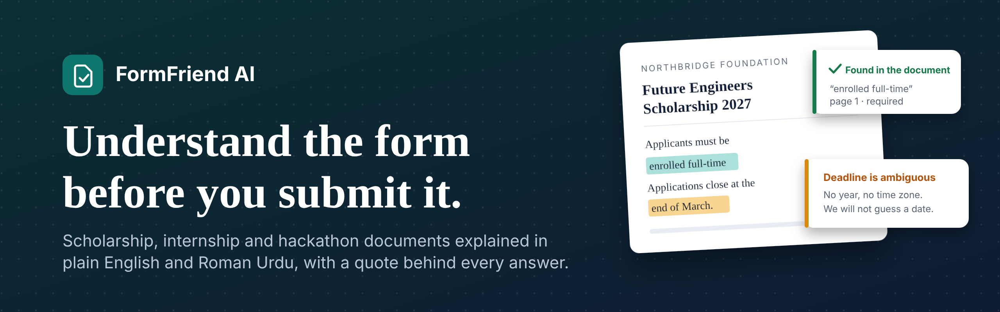
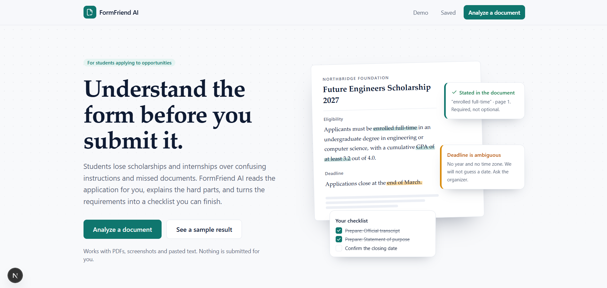

<p align="center">
  
</p>

<p align="center">
  
  
  
  
  
  
</p>

# FormFriend AI

**Understand the form before you submit it.**

Students lose scholarships, internships and competitions because the instructions are confusing, a
deadline is vague, or a required document is missed. FormFriend AI reads an application document
(PDF, screenshot or pasted text), explains the hard parts in plain English and Roman Urdu, and turns
the requirements into a personal checklist. **Every claim comes with the quote it was based on.**

Built for the Meta Global AI Developer Hackathon. Works with Groq or Meta Model API.

<p align="center">
  
</p>

## Why it is different

Most "chat with a PDF" tools sound confident even when they guess. FormFriend AI is built to say
"I am not sure" when the document is not clear.

- **No invented deadlines.** A date is only "verified" if it has a day, month, year and a matching quote. A vague "end of March" is flagged as ambiguous. A countdown only appears when the time zone is known.
- **Every quote is checked.** The server confirms each quoted passage really exists in your document and marks it **unverified** if not.
- **Eligibility is computed by code**, not by the AI. A missing fact in your profile is never treated as a match.
- **Your data stays with you.** Saved items live in your browser. Nothing is stored on our servers.

## Features

| Feature | How it stays honest |
| --- | --- |
| **Upload** PDF, PNG, JPG or paste text | Text PDFs are read directly. Scanned PDFs and images use OCR in the browser. Corrupted, password-protected and unreadable files get a clear message. |
| **Structured analysis** of eligibility, documents, dates, fees, steps | Every item carries a quote and page number, checked against the document. |
| **Deadline intelligence** | Dates are shown exactly as written. Ambiguous dates are flagged, never guessed. |
| **Eligibility matcher** | Each criterion is *meets*, *does not meet* or *needs verification*, with the reason and the part of your profile it used. |
| **Preparation checklist** | Built from the document's own requirements. Tasks are labelled *From the document* (with the quote) or *Recommended*. Progress is saved. |
| **Ask your document** | Answers come only from the document, with quotes. If the document does not say, the app says so. |
| **Saved opportunities** | Dashboard with progress, deadline status and a side-by-side comparison. |
| **Demo mode** | Three fictional sample documents work without an API key. They are labelled as samples. |
| **Roman Urdu** | Explanations and chat answers can be switched to Roman Urdu. |

FormFriend AI never submits an application for you.

## Tech stack

| Area | Tools |
| --- | --- |
| App | Next.js 15 (App Router), React 19, TypeScript |
| UI | Tailwind CSS 4, lucide-react, class-variance-authority |
| AI | Any OpenAI-compatible API: Groq (default `openai/gpt-oss-120b`) or Meta Model API |
| Validation | Zod 4 (JSON Schema for model output, runtime checks) |
| Document reading | PDF.js, Tesseract.js (OCR, self-hosted, runs in the browser) |
| Storage | Browser localStorage (no database) |
| Quality | Node test runner (80 tests), ESLint, axe accessibility checks |

## Quick start

Requires **Node.js 20 or newer**.

```bash
git clone <your-repo-url>
cd formfriend-ai
npm install          # also copies PDF.js and OCR files into /public (postinstall)
cp .env.example .env.local
# add your key to .env.local (see below), then:
npm run dev          # http://localhost:3000
```

Without an API key everything except live analysis, eligibility checking and chat works, including
the three sample documents.

## AI provider key (Groq or Meta)

The app talks to any OpenAI-compatible chat API. Pick one:

**Groq (works worldwide, free tier)**

1. Open <https://console.groq.com/keys>, sign in and choose **Create API Key**.
2. Copy the key (it starts with `gsk_`) and put it in `.env.local`:

```
GROQ_API_KEY=your_key_here
```

Defaults for Groq: base URL `https://api.groq.com/openai/v1`, model `openai/gpt-oss-120b`.
Change the model with `META_MODEL` (for example `openai/gpt-oss-20b`).

**Meta Model API** (if dev.meta.ai is available in your region)

1. Open <https://dev.meta.ai/>, go to the **API keys** tab and create a key (starts with `LLM_`).
2. Put it in `.env.local` as `MODEL_API_KEY=your_key_here`. Defaults: `https://api.meta.ai/v1`,
   model `muse-spark-1.3`.

Other overrides: `META_API_BASE_URL`, `META_MODEL`. If both keys are set, `MODEL_API_KEY` wins.
The key is only read on the server. It is never sent to the browser.

Structured output uses `response_format: { type: "json_schema" }`. If a model rejects that with
HTTP 400, the server retries once in plain JSON mode with the schema in the prompt. Either way,
every answer is validated and every quote is checked against your document.

> Status: the pipeline is tested end to end against a mock of the OpenAI-compatible API. Run it once
> with your real key and a real document before demoing, to check output quality and Roman Urdu wording.

## Deploy to Vercel

1. Push this folder to a GitHub repository (`.env.local` is git-ignored; do not commit it).
2. In Vercel choose **Add New, Project**, import the repository. Next.js is detected automatically.
3. Under **Environment Variables** add `GROQ_API_KEY` (or `MODEL_API_KEY`).
4. Deploy. `npm install` runs the postinstall step that copies the OCR and PDF assets.

There is no separate backend. The three API routes (`/api/analyze`, `/api/eligibility`, `/api/chat`)
run as serverless functions with a 60 second limit. Check that your Vercel plan allows that duration.

## How it works

```
Browser                                   Server (Next.js API routes)            AI provider
-------                                   ---------------------------            --------------
PDF text (PDF.js) or OCR (Tesseract)  -->  validate input, rate limit
text + page numbers                        build prompt (document = untrusted)  -->  model (JSON schema)
                                           parse + Zod-validate answer          <--
                                           check quotes against the document
                                           guard dates, downgrade weak claims
result with evidence                  <--
localStorage: saved items, checklist, profile
```

- **Untrusted documents.** Document text is placed between tags and the model is told to treat it as
  data. Output must match a JSON Schema and is validated again with Zod.
- **Evidence checks** live in `lib/ai/verify.ts`. **Date guard** is in the same file.
- **Eligibility** (`lib/ai/eligibility.ts`) rejects any "meets" verdict that does not quote text
  actually present in your profile, and computes the overall status itself.
- **Long documents:** the app sends the pages most relevant to the task, up to a size budget (12,000 characters on Groq, 60,000 otherwise; change it with `AI_CONTEXT_CHARS`). Quotes are still verified against the whole document. Chat sends page 1 plus the pages most related to the question.

### Project structure

```
app/                 pages and API routes (analyze, eligibility, chat)
components/          UI: upload, analysis, eligibility, checklist, chat, saved
lib/ai/              AI client, prompts, verification, eligibility, chat, rate limit
lib/parsers/         PDF text extraction and OCR
lib/schemas/         Zod schemas (analysis, eligibility, chat, saved opportunity)
lib/storage/         localStorage persistence (guarded against missing or full storage)
lib/utils/           date logic and checklist builder (pure functions)
lib/demo/            fictional sample documents and their reference results
scripts/             postinstall asset copy
```

## Privacy

- Document text and your profile are sent to the configured AI provider (Groq or Meta Model API) to be analyzed. Only what each feature
  needs is sent: eligibility checks send your profile and the criteria, not the whole document.
- Nothing is stored on this app's servers. Saved opportunities, checklist progress and your profile
  live in your browser's localStorage and never leave your device.
- Server logs never contain document text.
- Do not upload documents that contain passwords or ID numbers.

## Security

- API key is server-only. Request bodies are size-limited and validated.
- Per-IP rate limiting on all API routes. It is in-memory, so on serverless hosting it slows abuse
  but is not a hard guarantee. For a hard limit, back `lib/ai/ratelimit.ts` with a shared store such
  as Upstash Redis or Vercel KV.
- Production responses send a Content Security Policy, `X-Frame-Options: DENY`, `nosniff`, a strict
  referrer policy and a restrictive permissions policy. API responses are `no-store`.
- `npm audit --omit=dev` reports 0 vulnerabilities. PostCSS is pinned through `overrides` in
  `package.json` because the copy bundled with Next 15 is flagged. The remaining dev-only warnings
  come from the ESLint toolchain and are not part of the shipped app.

## Known limitations

- OCR reads English and Roman Urdu (Latin script). Urdu in Arabic script is not supported.
- Browser OCR can make small mistakes, especially on phone photos. The app shows the extracted text
  so you can check it, and quote verification catches many errors.
- Saved items are per browser and per device. Clearing site data deletes them.
- Long documents are only partly sent to the model (see `AI_CONTEXT_CHARS`), so details on skipped pages can be missed.
- AI output can be wrong. The app always tells users to confirm against the original instructions.

## Scripts

| Command | Purpose |
| --- | --- |
| `npm run dev` | Development server |
| `npm run build` / `npm start` | Production build and server |
| `npm run lint` | ESLint |
| `npm test` | 80 tests, no API key or network needed (see below) |

## Tests

`npm test` runs unit tests and an integration test of the whole server pipeline, using a small mock
of an OpenAI-compatible API (`tests/helpers/mock-meta.ts`). No key or network is needed.

- **Guards:** date rules (no year, no time zone, ambiguous or malformed dates), quote verification,
  eligibility overall status, checklist generation, page selection for long documents.
- **Three sample documents** (scholarship with an ambiguous deadline, internship with missing
  eligibility information, hackathon with a verified deadline) go through `/api/analyze`,
  `/api/eligibility` and `/api/chat`.
- **Failure handling:** a model that invents a deadline, a quote or a profile fact is caught;
  malformed model output is retried once; upstream 401/429/500 become clear errors; a missing API
  key gives a friendly 503; prompt injection in the document or the question stays inside its data
  block; rate limiting; bad input.

The tests were also checked by deliberately breaking each guard and confirming a test fails.

They do not call a real AI provider, so run the app once with your key and a real document to check
the model's actual output quality.

## Troubleshooting

- **"AI features are not set up"**: `GROQ_API_KEY` / `MODEL_API_KEY` is missing or the server was not restarted after
  editing `.env.local`.
- **PDF or OCR does not start**: run `npm install` again so `public/pdf.worker.min.mjs` and
  `public/tesseract/` exist.
- **"You are going a little fast"**: the per-IP rate limit was hit. Wait a minute.
- **"AI service rate limit was reached"**: the free tier of the AI provider allows only a few requests
  and tokens per minute. Wait a minute, use a smaller document, or lower `AI_CONTEXT_CHARS`.
- **"This document is too large for the AI model's limit"**: lower `AI_CONTEXT_CHARS` or pick a model
  with a higher limit through `META_MODEL`.
